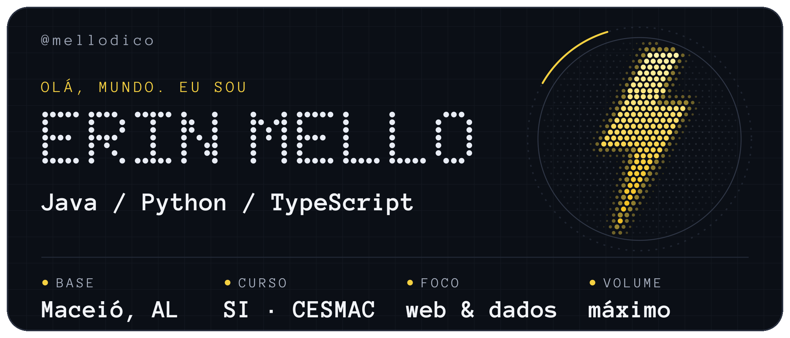

  

 
## stack
 

 
## projetos
 
- [**Tanquei**](https://github.com/mellodico/Tanquei) ([demo](https://tanquei-al.vercel.app)): preço de combustível em Alagoas, com dados da API EconomizaAlagoas e histórico diário. React, Express, PostgreSQL
- [**Sapopedia**](https://github.com/mellodico/sapopedia): sistema web colaborativo sobre sapos, rãs e pererecas do Brasil, com wiki, galeria e fórum. Spring Boot, Thymeleaf, PostgreSQL
- [**CineList**](https://github.com/mellodico/watch-cinelist): watchlist de filmes com busca na API do TMDB, notas e status. FastAPI, React, PostgreSQL.
- [**srhp-avl-product-recommender**](https://github.com/mellodico/srhp-avl-product-recommender): recomendação hierárquica de produtos com árvores AVL e busca em O(log n). Python, Docker
- [**Helptopia**](https://github.com/mellodico/Helptopia): Plataforma interativa de guia para iniciantes do jogo Heartopia! Node.js, Express, EJS.
## contato
 
[LinkedIn](https://www.linkedin.com/in/erinmello) · erinsmello@gmail.com
 
